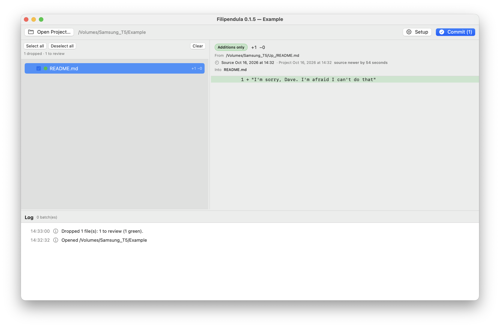

# Filipendula

[](https://github.com/njazz/Filipendula/actions/workflows/build.yml)



**Drop new versions of files onto a project and see, at a glance, which ones are safe to merge.**

Filipendula is a small macOS app (plus a CLI) for reviewing and merging file updates, such as code you received from a colleague, a download, or an AI assistant. It compares each dropped file to its original in your project with a plain line diff and colors the result:

| Color | Meaning |
|---|---|
| 🟢 green | only additions: nothing from the original is lost |
| 🟡 yellow | some original lines are removed |
| 🔴 red | the new file only deletes, adds nothing |
| 🟤 dark red | adds code but drops a large share of the original (default ≥ 40 %): looks truncated or rewritten |
| ⚪ grey | identical: *no diff*, nothing to merge |
| 🔵 blue | not in the project |

Everything is algorithmic and local: no network, no AI, no telemetry. Every commit makes verified backups first and can be undone.

## Features

- Open a project folder, then drop files or whole folders anywhere on the window.
- Colored tree with checkboxes, multi-selection, folder roll-ups and a diff pane with line numbers.
- Matches dropped files by relative path, then by unique filename; ambiguous names get a best guess and a picker.
- **Files that don't exist in the project are never added** (unless you turn that on), and the UI says so explicitly.
- Compares modification dates too ("source OLDER by 3 days" is a hint of a stale copy).
- Commit = one batch: verified backups, atomic writes, journal. **Undo** restores from the backups, but only if they are intact and the file wasn't edited since.
- Optional: move the dropped files to the Trash after a successful commit (with confirmation).
- CLI with the same engine and the same journal (`plan`, `apply`, `log`, `undo`, `prune`).

## Install

Requires macOS 13+ and Xcode 15+ (Swift 5.9).

```bash
git clone <this repo> && cd Filipendula
./scripts/make_app.sh          # builds build/Filipendula.app (universal) and a zip
open build
```

Drag `Filipendula.app` to `/Applications`. A self-built app opens normally; a build downloaded from elsewhere needs right-click → Open (or `xattr -dr com.apple.quarantine Filipendula.app`) unless it is signed and notarized (see below).

For development: `./run.sh` builds a debug bundle and launches it. `swift run` / Xcode's package scheme produce a bare executable without an icon; use the bundle scripts or the optional Xcode project (`brew install xcodegen && xcodegen`).

CLI: `swift build -c release --product filipendula && cp .build/release/filipendula /usr/local/bin/`

## Using the app

1. **Open Project…** and pick the folder (or drop a single folder onto an empty window).
2. **Drop** files or folders. Green files are checked automatically.
3. **Review**: click a row for its diff; ⌘/shift-click to select several rows and flip their checkboxes together. *Select all*, *Deselect all* and *Clear* sit above the tree.
4. **Commit**. Yellow and red files ask for confirmation first.
5. **Undo** any batch from the log at the bottom.

Everything configurable is behind **Setup** (⌘,): thresholds, adding new files, Trash after commit, confirmations, diff context, backup maintenance.

## How it decides

Lines are compared after normalizing line endings (and, by default, trailing whitespace), using Myers' diff (`CollectionDifference`). The counts decide the color:

- no added and no removed lines → identical
- no removed lines → green
- removed ≥ threshold of the original **and** something added → dark red
- nothing added → red
- otherwise → yellow

Binary files (NUL byte in the first 8 KB) are compared by hash and shown as yellow "binary replaced".

## Safety model

- **Backups first.** Originals are copied to `<project>/.merge_backup/<batch>/` and each copy's SHA-256 is verified before anything is written. A mismatch aborts the batch untouched.
- **Atomic writes**, each verified by hash; a failure rolls the whole batch back.
- **Stale plans are refused**: if a file got worse between review and commit, nothing is written.
- **Journal** (`.merge_backup/log.jsonl`, append-only) survives crashes; an interrupted batch is offered for rollback on next open.
- **Undo is per file and cautious**: a corrupt or missing backup is skipped and reported (never restored from bad data); a file edited since the commit is skipped unless you confirm.
- **Paths are validated**: no `..`, absolute paths, symlink escapes, `.git`, or `.merge_backup`.
- Moving sources to the Trash is opt-in, asks first, uses the real Trash (recoverable), and skips any source that changed after the commit.

Add `.merge_backup/` to your `.gitignore` (Setup has a button, or `filipendula gitignore <project>`).

## CLI

```
filipendula plan  <project> <sources...> [--json] [--show-all] [--loss-threshold 40] [--strict-whitespace]
filipendula apply <project> <sources...> [--include green,blue,yellow,red,darkred,all]
                                       [--add-new] [--trash-sources] [--accept-ambiguous] [-y]
filipendula log   <project> [--json]
filipendula undo  <project> [batch-id-or-prefix] [--force]
filipendula prune <project> [--older-than 30] [-y]
filipendula gitignore <project>
```

`plan` is a dry run and exits 2 if anything is red. `apply` defaults to green (and blue only with `--add-new`). The app and the CLI share one journal, so either can undo the other's batches.

## Development

```bash
swift test                 # classifier, apply/undo/integrity, new-file and Trash rules, prune
./scripts/make_app.sh      # release bundle;  VERSION=1.2.0 and SIGN_ID=... are supported
```

```
Sources/MergeCore      all logic (no UI): Classifier, Scanner, Matcher, Planner, Journal, Operations
Sources/filipendula      CLI
Sources/FilipendulaApp   SwiftUI app
Tests/MergeCoreTests   unit tests
scripts/               make_app.sh, version.sh, gen_icon.py
```

The version lives in `Sources/MergeCore/Version.swift` (and `MARKETING_VERSION` in `project.yml`). A GitHub Actions workflow tests and builds once a day, and only when the code changed since the last successful build.

**Distributing a signed build:**
`SIGN_ID="Developer ID Application: Name (TEAMID)" NOTARY_PROFILE=myfilipendula ./scripts/make_app.sh`
(store credentials once with `xcrun notarytool store-credentials`). Change `BUNDLE_ID` to an identifier you own.

## Limitations

- One writer at a time per project (the journal is not locked).
- Line-based diff: a moved block counts as a delete plus an add (yellow).
- Backups stay until pruned. Pruned batches can't be undone.

## License

[MIT](LICENSE)
